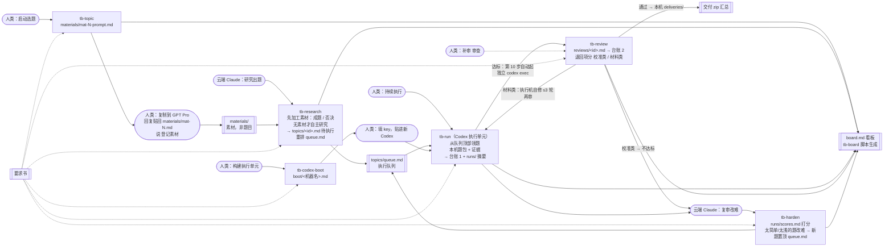

# TB-Science 任务

- 目标：按 [要求书](../../specs/tb-science-requirements.md) 持续生产可交付的科学任务数据。
- 整体状态：全新部署（流水线就位，尚未登记执行机，尚未跑过题）。
- **人类看结果：[board.md](board.md)**（脚本生成的静态看板）。

## 流水线

| 单元 | 口令 | 执行方 | 读 | 写 |
| --- | --- | --- | --- | --- |
| [tb-topic](../../skills/tb-topic/SKILL.md) | `启动选题` / `登记素材 <素材号>` | 任意 Agent | 要求书第一阶段、台账 1、`topics/`、`materials/` | `materials/<素材号>-prompt.md`；登记 `materials/<素材号>.md` 为待加工 |
| [tb-codex-boot](../../skills/tb-codex-boot/SKILL.md) | `构建执行单元 <机器名>` | 任意 Agent | 模板 | `boot/<机器名>.md` |
| [tb-run](../../skills/tb-run/SKILL.md) | `持续执行` / `执行题目 <题号>` | Codex 执行单元 | `topics/` 中待执行的题、要求书二至四阶段 | 本机题包与证据；[台账 1](ledger/tasks.md) 一行；[runs/<题号>/](runs/README.md) 运行摘要 |
| [tb-review](../../skills/tb-review/SKILL.md) | `审查` / `审查 <题号>` | tb-run 第 10 步自动起的独立 `codex exec` 进程；补审时人类在执行机另开对话说 | 台账 1、台账 2、本机证据、要求书 | 本机每道达标未审题一份 `reviews/<题号>.md` 和[台账 2](ledger/reviews.md) 一行；退回题置顶 queue.md |
| [tb-research](../../skills/tb-research/SKILL.md) | `研究出题` | 云端 Claude（手动或定时，prompt 见 [boot/cloud-research.md](boot/cloud-research.md)） | `materials/` 待加工素材、tb-topic 提示词、要求书第一阶段、`topics/`、`runs/` | 一轮 ≥ 3 件：先给队列顶部 ≤ 3 道旧题回补首发解检验（`对抗清单：v1（回补）` 或 `退回出题`）；素材 → `已加工 / 已否决`，每个可成题候选各一道 `topics/<题号>.md`（按 [对抗出题规范](adversarial-design.md) 设计，头部 `对抗清单`，草稿含 `first_shot.py`）；重排 [queue.md](topics/queue.md)（对抗档在前） |
| [tb-quick](../../skills/tb-quick/SKILL.md) | `快速出题` | 出题侧 Claude（云端或本地，可多开，不需要 key / Docker） | `materials/` 待加工素材、要求书第一阶段、对抗出题规范、calibration-models、scores、`topics/` | 一轮 ≥ 5 道 `topics/<题号>.md`（头部“来源对话：快速出题…”“对抗清单：…首发解 未实跑（执行机闸门）”“草稿：无”）；素材裁决；按 tb-research 第 6 步重排 queue.md |
| [tb-harden](../../skills/tb-harden/SKILL.md) | `复审改难` | 出题侧 Claude（云端或本地，手动或定时；可多开） | `runs/<题号>/`、原题、要求书 1.2 与 3.2、对抗出题规范、`claims/` | [runs/scores.md](runs/scores.md) 行与 [对手档案](adversarial-design.md#f-对手档案只追加) 行；改难新题 `topics/<新题号>.md`（有旋钮的拧旋钮，没有的全套对抗设计）置顶 queue.md；过程中的 `claims/harden-*.md`（做完删除） |
| [tb-prescreen](../../skills/tb-prescreen/SKILL.md) | `预筛 <题号>`（tb-research / tb-harden 写题时自动） | 本机有弱模型 key 和 Docker 的 Agent | `drafts/<题号>/`、题“核心难点”、本机 `.env` | `drafts/<题号>/prescreen.md`（每次探针一节）、题头部 `预筛` 行；影响 queue.md 排序 |
| [tb-board](../../skills/tb-board/SKILL.md) | `刷新看板` | 任意 Agent | topics、queue、两个台账、runs | [board.md](board.md) |

## 目录

| 路径 | 内容 |
| --- | --- |
| [board.md](board.md) | 结果看板（脚本派生，人类唯一入口） |
| [calibration-models.md](calibration-models.md) | 校准模型名单、目标难度带（要求书 3.2 原文）、弱模型弱点画像、实证修正；出题提示词第四节整段引用它 |
| [adversarial-design.md](adversarial-design.md) | 对抗出题规范：目标与底线、GPT 5.6 对手画像、六种对抗手法、首发解、对抗清单与加难旋钮、对手档案（复审改难只追加）；三条出题链路与 tb-run 首发解闸门都读它 |
| [ledger/tasks.md](ledger/tasks.md) | 台账 1：已完成题目（唯一事实） |
| [ledger/reviews.md](ledger/reviews.md) | 台账 2：审查结果（唯一事实） |
| [materials/](materials/README.md) | GPT Pro 回复（素材，待 tb-research 加工） |
| [drafts/](drafts/README.md) | 每道待执行题的可运行草稿（题面、生成器、参考解、验证器），云端实跑过，执行机题包的起点 |
| [topics/](topics/README.md) | 可执行的题（素材加工 / Claude 研究 / 改难）与执行队列 [queue.md](topics/queue.md) |
| [claims/](claims/README.md) | 占用文件：多个对话同跑一条口令时占住一件事，带 2 小时租期，做完删除 |
| [boot/](boot/README.md) | 各执行机的启动 prompt（占位符版）、[registry.md](boot/registry.md) 执行机登记、云端定时任务 prompt |
| [reviews/](reviews/README.md) | 单题审查详情 |
| [runs/](runs/README.md) | 每道题各次 `harbor run` 的摘要与 calibration.md 副本（原始轨迹留本机）；[scores.md](runs/scores.md) 复审打分 |
| [steps/01-merge-specs/](steps/01-merge-specs/README.md) | 历史：三份原始要求合并成要求书的记录 |

## 已定决策

改规则时在表里加一行；2026-10-29 起新行末尾须写一句“对进行中的题：无影响 / 从第 N 步起按新规则 / 需重判”，执行中的 Agent 在 [规则同步](../../AGENTS.md#规则同步) 时据此处理手上的题。

| 日期 | 决策 |
| --- | --- |
| 2026-10-28 | 要求书 C1、C2 冲突取交集合并（见 [步骤 01](steps/01-merge-specs/README.md#裁决2026-10-28用户决定)）；题包目录格式按《交付要求》§1。 |
| 2026-10-28 | 选题全部交给 GPT Pro 网页对话；仓库维护 tb-topic 产出提示词；GPT Pro 的输入输出由人类搬运。 |
| 2026-10-28 | 审查只保留一个最终门禁（tb-review），中间不设人工评审；门禁只按要求书已有条目判定，不新增建议，不过度严格。 |
| 2026-10-28 | 仓库定位为“固定 Skill + 流水线”，人类用口令驱动；任务事实只记在 `ledger/` 两个台账，人类直接在 GitHub 看。 |
| 2026-10-28 | 执行单元：2 台 Windows 上的 Codex（可用 GPT 5.6 Sol (max)、GPT-6 Astra），能 clone 本仓库；弱模型拟用 deepseek1017，key 由人类填入启动 prompt，不进仓库。题包与轨迹留执行机本地，台账只记位置。运行环境搭建暂不处理。 |
| 2026-10-28 | 多会话并发规则写入 AGENTS.md：先拉再算、推送即占有、只动自己的文件、撞上就停、回报只说固定几行。起因：三个会话同时 `启动选题`，产生 tbs-001 / tbs-002 两份近似提示词和多种格式的回报。 |
| 2026-10-28 | tb-run 第一轮打磨：校准唯一入口 `harbor run`（被试由 Harbor 在干净容器里新起，构建会话不做题）；弱模型先跑，通过则查绕过或判候选不达标，不跑强模型；候选不达标自动换下一候选，三个用尽才登记不达标；弱模型接入方案 A（Codex 配第三方 provider）优先、B（Harbor Terminus）兜底。启动 prompt `.env` 增加 `OPENAI_API_KEY`。 |
| 2026-10-28 | tb-run 第二轮：新口令 `持续执行`，执行机自己从 `topics/` 领题号最小的待执行题，做完领下一题，领不到即回报空闲并停；撞题换下一题；本机故障标该题 `阻塞` 并停循环。每次 `harbor run` 的摘要和 calibration.md 副本随台账行推到 `runs/<题号>/`，为以后复审失败轨迹、改难选题留埋点；原始轨迹仍留本机。不自动审查。 |
| 2026-10-28 | 第三轮（外部专家反馈：难点是把题做到 GPT 5.6 Sol (max) with Codex 通过 1–2/4）：加第二个出题入口 `研究出题`（云端 Claude 自己研究出题，直接待执行，不经人类；待执行 ≥ 6 题时只排序不出题）；题库队列 `topics/queue.md`，执行机从顶部领；`复审改难` 读 `runs/` 摘要打分，太简单/太浅的题改难成新题置顶，原题不重跑，太难的只记录；`board.md` 看板由脚本派生，人类唯一看结果入口。两条云端口令先手动跑通再建定时任务。 |
| 2026-10-28 | 第四轮：`审查` 不再绑题号，在执行机上另开 Codex 对话说 `审查`，审本机全部已执行未审的题；退回的题自动改回 `待执行（退回，<执行机>）` 并置顶队列，只有原执行机领回修。GPT Pro 回复降级为素材进 `materials/`，`登记素材` 只做松检查；`研究出题` 先加工素材（成题或否决，不是每份素材都成题），没素材才自主研究。tbs-001–003 不回炉。 |
| 2026-10-28 | 用户决定：tbs-001–003 也降级为素材 mat-001–003（含提示词），题库清空，题号从 tbs-001 重新分配，由 `研究出题` 重新加工入库。建立 `研究出题` 的云端定时任务供测试。 |
| 2026-10-28 | `研究出题` 改为目标制：一轮至少推进 5 件（成题或否决各算 1 件）且素材清零，一份素材的每个可成题候选各成一题；待执行上限 6 → 15（后提至 50）。定时任务由用户在 claude.ai 界面建（仓库、模型 claude-fable-5-1、Effort high 在界面选，API 建的任务起的新会话不带私有仓库凭据，已删除）；prompt 见 [boot/cloud-research.md](boot/cloud-research.md)。 |
| 2026-10-28 | 定时任务首跑成功：mat-001–003 → tbs-001–005。修正 tb-run 领题规则措辞漏洞：同机第二个 `持续执行` 对话见到 `执行中（win-a）` 误套“撞上就停”；现在 `持续执行` 对任何非可领状态（含本机其他对话占的）一律跳过换下一题，同机允许多个做题对话。 |
| 2026-10-28 | win-a 首次 `harbor run` 阻塞根因：Harbor 0.25.0 对离线任务用 nftables 出口控制 sidecar，探测守护进程内核 `CONFIG_NFT_FIB_INET`；win-a 的 WSL 2.5.9 内核 6.6.87.2 缺该选项（`CONFIG_NFT_FIB_IPV6` 未设），源码无绕过参数。修法：升级 WSL 到 ≥ 3.0.3（内核 6.18.x，config-wsl 含 `CONFIG_NFT_FIB_INET=m`），依据 [harbor#2527](https://github.com/harbor-framework/harbor/issues/2527)。不切 Hyper-V（LinuxKit 内核同样缺）、不自编内核、不改任务 network_mode。启动 prompt §0 加 WSL 内核自检。 |
| 2026-10-28 | 新增 macOS 执行机 `mac-a`。启动 prompt 模板改为跨平台（正斜杠路径、`~/.codex/auth.json`），§0 按系统列前提：Windows WSL ≥ 3.0.3；macOS Docker Desktop ≥ 4.86.0（LinuxKit 内核自该版起含 `CONFIG_NFT_FIB_INET`，依据 [harbor#2527](https://github.com/harbor-framework/harbor/issues/2527)）。自检命令同一条。其余 Skill 与系统无关。 |
| 2026-10-28 | 执行机初始化改为固定自助流程：启动 prompt §0 列出各系统的安装清单与三条验收（内核探测、oracle 断网冒烟、弱模型连通），Codex 自己装、自己调试（同一问题 3 次不解再问人类），不碰规则文件；就绪后自己在 `boot/registry.md` 登记。看板新增“执行机”表（就绪状态、正在执行、阻塞、执行登记次数、达标数、审查通过数）。 |
| 2026-10-28 | 弱模型 agent 默认改为 Harbor 自带 `terminus-2`，不再以 Codex 为首选：mac-a 实测 Harbor 0.25.0 的 codex agent 只接受 `openai_responses`，DeepSeek 等 Chat Completions provider 被拒；terminus-2 在宿主侧调模型，任务容器保持断网。强模型 Codex 在断网任务里用 `--allow-agent-host` 只放行 chatgpt.com / auth.openai.com / api.openai.com。 |
| 2026-10-28 | 审查并入 `持续执行`：tb-run 新增第 10 步，每题登记 push 后用 `codex exec` 新起独立 Codex 进程跑 `审查 <题号>`，结束后再领下一题；人类不再逐题说 `审查`，手动口令只作兜底。不让做题对话审自己（第 7 步 rubric 自检已是自审，再审只是盖章）；独立进程无做题上下文，等同另开对话。止损：同一题累计退回 3 次，领题时改 `阻塞` 交人类，继续领下一题。 |
| 2026-10-28 | 出题链路补难度带与弱模型画像：新建 [calibration-models.md](calibration-models.md)（名单、要求书 3.2 难度带原文、DeepSeek 画像“参考信息、未核实”、实证修正）；GPT Pro 提示词模板固定第四节整段嵌入它；topic.md 新增第 12 个字段“难度落点”（预测写死）；`研究出题` 判难度落点与排序时读它和 scores.md 的实测；`复审改难` 打分时记预测是否命中，系统性偏差追加到第 4 节。画像不是硬规则，否决只看要求书红线。旧题 tbs-001–010 不回填字段。 |
| 2026-10-28 | 出题 Agent 多干一步：topic.md 新增 `## 构建简报` 七小节（题面要点、数据生成规格与真值核对、验证器子检查与容差推导、参考解算法与步数构成、依赖版本、合理简化对照、已知不确定点）。依据：worker 在 tbs-006/008 上自行决定了生成器构成、真值核对、窗口与容差，而云端出题 Agent 有闲、worker 是瓶颈。简报是默认方案不是命令：云端没实跑，worker 偏离须记 `简报偏离`，自定须记 `简报缺口`，`研究出题` 下一轮读这些记录改进简报。`研究出题` 先给在排的 `待执行` 题补简报再加工素材；题包代码仍不进仓库。 |
| 2026-10-29 | 审查范围收窄：只审**达标**题。起因 tbs-006 被弱模型 34 步解掉、正确登记不达标后，第 10 步仍自动审查并按 checklist 退回 7 项（三条件、步数、rubric 对不达标题必然不满足）。不达标题登记即结束，摘要给 `复审改难`；tbs-006 的退回记录保留为历史，不执行。审查新增判定 `待人工`：要求书要求人做的领域复核缺失时不退回，结论写 `通过（待人工 N 项）`。同机多开零配置：启动 prompt 自己选不冲突的 clone 目录（repo、repo-2…）、环境已验收则跳过安装、registry 已有行不重复登记。看板不再把 `*-environment.md` 当机器。 |
| 2026-10-29 | 出题 Agent 再进一步：每题附**可运行草稿** `drafts/<题号>/`（题面、生成器、参考解、验证器、依赖），在云端实跑：参考解奖励 1、每个合理简化奖励 0、≥ 5 种子推导容差、独立真值核对。推翻此前“题包代码不进仓库”：泄漏面不变（镜像只从 environment/ 构建，repo 不进容器）。worker 从草稿起步，重心变为容器化、隔离、工程检查、校准。`研究出题` 一轮目标 5 → 3 件，先给待执行题补草稿。定时任务此前实际运行在 Sonnet 5.5（配置未存模型），其出的 12 道待执行题由 Fable 5.1 原号重写并补草稿，期间状态 `改写中（云端）`，不可救的标 `已撤回`。 |
| 2026-10-29 | 规则自动同步：各 Agent 在会话开始、`持续执行` 每轮领题前、tb-run 判定与登记前、每次提交前自动 `git pull` 并用 `git diff` 比对规则文件（`specs/`、`skills/`、AGENTS、两个 README、calibration-models）与本 clone `.git/tbs-rules-seen` 记的已读版本，有变化就重读改动文件和决策表新行、从下一步起照新规则做，不停、不问人类；新口令 `同步规则` 立即触发一次。监控：登记回报带 `规则版本`，看板总览显示规则最新版本。启动 prompt 口令增至五条并重生成。对进行中的题：无影响。 |
| 2026-10-29 | 成功轨迹深度按甲方反馈放宽：要求书改为**至少一条**成功轨迹 ≥ 60 个 agent 步，删除“每条 ≥ 100”和“批次 P50 150”，不按 output tokens 分档；条件 A、B、C 不变，GPT 5.6 的成功轨迹不要求每条达到。A/B/C 满足但全部成功 < 60 → 不补跑，判不达标交 `复审改难`。旧规则下判不达标、新规则下达标的题标 `待执行（重判，<原执行机>）` 置顶，由原执行机不新跑模型、补 rubric 与证据后登记；首个是 tbs-020（GPT 5.6 2/4，成功 61 / 52 步）。同步：tb-run 判定与领题、校准模板、审查 R13、复审改难（太浅定义与重判）、出题排序与题模板。 |
| 2026-10-29 | 执行器推进深度与审查解耦：起因 win-a 做 tbs-003 时按“同一问题 3 次不解就停”多次中断（tmux 缺失、依赖下载截断、远端同步失败），人类反复说“继续推进”。改为：执行单元中途不问、不等；同一障碍连续推进墙钟 ≥ 6 小时或 ≥ 10 种实质不同办法仍未解决才允许标 `阻塞`（题目不可用 / 本机故障，附起止时间与尝试清单），一条路卡住先走其他路（push 不通继续本地校准）。审查从 `持续执行` 中解耦：tb-run 不再有第 10 步，做完登记直接领下一题；审查由别的 Agent 在执行机另开对话以 `审查` 另行做。启动 prompt §0 的“3 次”规则同步撤掉。 |
| 2026-10-29 | 出题 Agent 的否决纪律：否决只能引要求书第一阶段红线原句或 5.1 近亲；“工具离线可行性未核实 / 简报写不出 / 预计偏易 / 规模小 / 多轮结构”都不是否决理由，必须改设计后成题（素材只是方向，数据、工具、判分可全换）。起因：src-001 的 41 个候选被 Sonnet 轮否决 36 个，约半数理由是“简报不可写”。mat-004–009 重置为 `待加工（复审）`，由 Fable 5.1 子代理重新加工，新题号从 tbs-016 起；待执行上限 15 → 50。看板素材表加候选数 / 成题 / 否决 / 待判。 |
| 2026-10-29 | 交付物统一为每道达标题一个压缩包 `<题号>-<task_id>-v<N>.zip`：标准题目（2.1 树）+ 判定用的真实轨迹及记录（A/B/C/深度引用的本版本有效运行，含 Harbor 原生输出与 `metadata.json`）+ 脚本生成的 README（目录说明、真实轨迹总结、未入包运行），另带 SHA-256 清单。规范 [skills/tb-run/delivery.md](../../skills/tb-run/delivery.md)，只用 `pack_delivery.py` 打包、`check_delivery.py` 自检，自检不过不得登记达标；其余运行留执行机、摘要照旧进 `runs/`。参考样例只借鉴清单、来源字段名、防泄漏思路。对进行中的题：从第 8 步起按新规则；已登记达标而未审查的题，由原执行机补写判定用运行的 `metadata.json` 并补打包，审查以压缩包为准。 |
| 2026-10-29 | Windows 执行机从占题到首跑常要 1.5–8.5 小时（mac 10–13 分钟），原因是同类环境问题每题重 debug。改为本机环境经验库：`environment-check.md` 固定三节（当前环境 / 坑与修法表 / 可复用产物），验证过的可复用件放 `env-kit/`；遇报错先查表，修好当场补行；坑表脱敏副本同步到 `boot/<机器名>-environment.md` 供同系统机器先读；领题前 1 分钟复检（读经验库 + `docker info`），环境故障在机器层面自愈，不占题、不产生运行记录。题文件记 `占题`、`首跑` 时间，运行元数据记分阶段用时，用于后续定位。云端不预设 Docker 方案（云端无法验证）。对进行中的题：无影响；各执行机下一次领题前把已有经验整理进三节格式和 `env-kit/`，并推一份 `<机器名>-environment.md`。 |
| 2026-10-29 | 审查精简为官方硬性条款的最小集合：checklist 换成 G1–G8，只取《验收标准》《交付要求》条款，不满足才退回；G1 由 `check_delivery.py` 判，其余只读题面、相似性自查、来源字段、engineering 汇总、calibration 名单与结论、rubric 不通过行，不复跑。《质量标准》其余验证证据不逐条审，缺失只在 evidence 中标“待验证”（4.2 原文允许），不退回。删除“待人工”：官方的人工复核只在《质量标准》出现且无签字或格式要求，改由独立审查 Agent 写“不看参考解的独立审题”“独立领域复核”两段 ≤5 行记录（复核者 AI，独立会话）；rubric 无关紧要项由审查直接驳回。对进行中的题：tbs-020 修复只需补 G3（题面公开判分用的数值门槛与随机规则）与随之解决的 G8（rubric #2、#16），G5 若缺错误解或绕过解实测则补；资源实测、攻击路径全集不必补；修完照常登记，按新表复审。 |
| 2026-10-29 | 出题侧两项优化（用户决定）：① `复审改难` 加占用锁：新建 [claims/](claims/README.md)，一件事一个占用文件，push 即占有、做完删除、心跳超过 2 小时可接手；打分阶段占全局 `harden-score`，改难占 `harden-<原题号>`，处置在打分时就定（太简单 / 太浅留空待改难），多个对话可同时跑。② 新 Skill [tb-prescreen](../../skills/tb-prescreen/SKILL.md)：出题侧用真实 DeepSeek API（deepseek-flash，Tier 1.5）在断网 Docker 里做一遍草稿；**可选**，key 只存本机 `.env`，云端没有 key 的 Agent 不做；结果只用于排序（`弱模型失败` > 未预筛 > `弱模型解出`），不是校准证据，不否决、不强制改难。`研究出题`、`复审改难` 的执行方改为“出题侧 Claude（云端或本地）”。对进行中的题：无影响。 |
| 2026-10-29 | 审查门按官方放宽，审查并入 `持续执行`。起因：tbs-020 v2 已达标（5.6 2/4、61 步），只因“题面没公开判分阈值”（G3，G8 重复计）被退回；改成 v4 公开 C1–C5 门槛后重新校准，结果不达标（1/4、44 步）。而官方 rubric #2 well_specified、#16 test_instruction_alignment 原文要求点名每个判分指标，不要求公开阈值（“State the metrics; withhold the numbers”）。checklist 因此调整：退回只认《验收标准》《交付要求》（含官方 rubric guidance），《质量标准》比官方严时按官方；G3 改为点名所有判分指标、交付路径与格式、随机规则即通过；G8 按官方 guidance 复判，只有 13 个核心项不通过、且影响科学核心或训练效果才退回，其余直接驳回；同一根因只计一次；退回项标 `校准类` / `材料类`。tb-run 新第 10 步：达标题登记后起独立 `codex exec` 审查；材料类退回自己修，最多 3 轮（只改材料不跑新模型、同版本重打包；改了作答可见内容或判分就版本 +1 重新校准）；校准类不修，登记不达标转 `复审改难`；通过就把 zip 复制到 `{{WORKDIR}}/deliveries/` 并记 SHA256SUMS，回报审查通过；3 轮仍退回才标阻塞并回报。手动 `审查` 只作补审。tbs-020 标 `待执行（重判，win-b）`，用 v2 交付包按新标准重审。对进行中的题：从下一步起按新规则；已登记达标但未审的题，在下一次登记或领回时走第 10 步。 |
| 2026-10-29 | `复审改难` 改为按范围全修（用户决定）：**在修范围** = A/B/C 满足只差深度（`太浅`），或 GPT 5.6 存在有效失败轨迹（通过 3/4、2/4、1/4、0/4；0/4 且 Astra 失败即 `太难`，往降难方向修）；在修范围的题**每轮全部处理**，不再一轮一道，顺序由近到远（太浅 → 3/4 → 太难）。范围外（5.6 4/4、弱模型真解、无效运行）不修，处置填 `不处理`，交给 `研究出题` 重新出题。修法分三种：太浅加深（保住已在带内的判断，补对正确解必不可少的独立验证类环节，不凑步数）、3/4 加难、太难降难。起因：上一轮按旧优先级先改了离目标最远的 tbs-001（4/4、最多 27 步），而唯一接近达标的 tbs-020（v4 5.6 1/4、弱模型失败、只差深度 44→60）排在最后没修。scores.md 已有 11 行范围外留空行一次性补 `不处理`（只追加规则的唯一一次例外）。对进行中的题：无影响（只改出题侧）。 |
| 2026-10-29 | `复审改难` 选题补一条跳过规则：原题处在 `执行中`、重判或退回修复中（或题文件写明暂不领）时，本轮跳过、处置留空。起因：按新范围首轮只有 tbs-020 待修，但它正按放宽后的审查门重判 v2（2/4、61 步），可能直接达标，改它会白做。对进行中的题：无影响。 |
| 2026-10-29 | 预筛改为**出题阶段快速探针**（用户决定）：取代同日“出完题再按正式规格跑一遍、只影响排序”的做法（实测 tbs-012 一次 35 回合 / 10.6 分钟 / 1.7M 输入 token，太慢太贵）。`研究出题`、`复审改难` 开局 `ds_prescreen.py --check`，有 key 就默认做、不问人类，但第一句话告知用了 key；没 key（云端）照旧。写题第 5 步草稿跑通后：思路探针（1 次调用约 1 分钟，DS 看题面与数据概览说做法与陷阱）→ 短跑探针（≤ 25 回合、≤ 8 分钟、解出即停）；思路探针只作参考（实测 tbs-012、tbs-020 的陷阱都被 DS 全部点出，但 tbs-020 实跑失败，点出 ≠ 做出）；短跑解出 = 题出得不行，当场改设计，最多 3 轮，仍不行暂不成题（候选留待判，不算否决）。通过的题头部记 `预筛：通过`，排序最前档。不是校准证据。对进行中的题：无影响。 |
| 2026-10-29 | `研究出题` 加素材占用：加工一份素材前占 `claims/research-<素材号>.md`（2 小时租期，同 harden），素材头部 2 小时内的 `加工中` 标记也视为占用；多对话时可一个从小号、其余从大号取。起因：本机同时有 4 个研究出题会话，旧规则都取“编号最小的待加工素材”，必然撞车。对进行中的题：无影响；进行中的研究会话从下一份素材起按新规则。 |
| 2026-10-29 | 外部素材入库门槛下调（用户决定）：tb-topic 新增“外部素材入库”，入库只挡占位/空条目（a）、领域无法归类（b）、重复（c），其余全收；素材提供者不写原创性、来源性质、难度、可判分性等结论，原题原文与原始元数据原样保留，判断全部交给 tb-research 否决纪律。起因：src-002（85 题）和 src-003（1060 题）入库时被提供者初筛挡掉大半。按新口径把两批增量重新入库。对进行中的题：无影响；对已被占用的 mat-014、mat-015：无影响。 |
| 2026-10-29 | 达标版本保护，tbs-020 结案。起因：tbs-020 v2 已达标，为补一条审查意见（公开阈值）改出 v4 后重新校准，结果不达标，合规的达标轨迹被一次修复毁掉。新规见 [tb-run“达标版本保护”](../../skills/tb-run/SKILL.md#达标版本保护)：达标版本自检 `ok` 后立即冻结，zip 复制到 `{{WORKDIR}}/deliveries/frozen/` 设只读，题头加 `达标版本` 行（含 SHA-256 与判定运行），判定用的运行目录只读；不得覆盖、删除或重打包冻结包；重判和修复只从冻结 zip 起步，重打包后核对 MANIFEST。审查退回新增 `题面类`：要改 `instruction.md`、`environment/` 或 `tests/` 的条目，对已有达标版本的题必须引硬性条款原句才能标；自动修复永远不改题面、不为修复重跑模型，遇到题面类就停下交人类。人类批准做 v<N+1> 时 v<N> 原样保留，新版本不达标不推翻 v<N> 的达标结论。tbs-020 由用户定稿：交付 v2 冻结 zip（SHA-256 `ec90c869…`，gpt56-1 有 61 个 agent 步，每步是一次独立的模型调用），台账 1、台账 2 记 v2 通过（用户定稿），移出队列，`复审改难` 不处理，本题结束。对进行中的题：从下一步起按新规则；已达标、未冻结的题，由原执行机下次领题前补冻结。 |
| 2026-10-29 | `复审改难` 范围再放宽（用户决定）：**弱模型没做出来的都修**（条件 B 成立，含有效的预算耗尽与输出失败），5.6 通过 4/4 的也修；只有弱模型真解、无效运行、已达标不修。5.6 通过 3/4、4/4 的加难目的是**拉长 GPT 5.6 成功轨迹**（至多 2/4、至少一条 ≥ 60 步）：陷阱只能从数据诊断得出、分层暴露（第一遍结果须自查才暴露下一层）、关键事实放在附带材料里须定位核对、保住弱模型失败点、判分只点名指标不公开数字；不得靠拉长题面、格式陷阱、堆量、限资源。依据：本库 tbs-001/003/018 三道 4/4 题的陷阱都能从题面或样本表读出（calibration-models.md 第 4 节）；外部 IdeaAMBIG（模型自己定位方法缺口仅 9.6%）、Toloka（GPT-5.6 提前停止、约九成最终写入不回读核对）。scores.md 中 tbs-003、tbs-018 两行处置由 `不处理` 改回空（只追加规则的又一次一次性例外），tbs-020 旧行补 `不处理（v2 已达标结案）`。对进行中的题：无影响（只改出题侧）。 |
| 2026-10-29 | 短跑探针默认预算 25 回合 / 8 分钟 → 40 回合 / 12 分钟（用户决定）。依据：8 分钟内 tbs-012、tbs-020 都没写出结果，“未解出”无信息；tbs-012 长跑第 21 回合出结果、第 35 回合（10.6 分钟）解出，DS 每回合 18–30 秒。同时修正两处让探针偏弱的问题：超时命令在容器内一并杀掉（之前残留进程让 DS 花 7 回合杀进程）；上下文保留全程、只截短 6 回合前的输出（之前只留 10 回合，DS 反复重读自己的文件）。预算用完后给 3 个收尾回合，要求用当前最好的方法写出结果再验证，“没写完”不再等于“未解出”。思路探针仍只作参考。对进行中的题：无影响。 |
| 2026-10-29 | 默认探针改为**一次性探针**（用户决定：出完题大概测一下，不开大环境、不跑很久）：DS 看题面与数据概览写一份完整脚本，断网跑一次（≤ 180 s）后验证，只回传脚本自己的输出让它最多修两次；默认关闭 DS 思考（`reasoning_effort=none`，实测每次调用约 30 秒、6 千 token；开思考要 220–290 秒、4–5 万 token），全程约 1.5–3 分钟、一个用完即删的容器。一次性解出 = 太简单，改设计；未解出不代表合格。12 分钟短跑改为人类点名才用；思路探针可选参考。对进行中的题：无影响。 |
| 2026-10-29 | 外部素材入库可以给批量族候选分档位、标代表实例（用户决定：全部保留，只加档位标签）：src-003 的 102 个 Vision2Code 零件族分 A1 带工程标准 47 / A2 有明确物理或工程机理 16 / B 以形状为主 39，A 档放在 mat-020–022，B 档放在 mat-023–024，MoonCAD 改为 mat-025、mat-026；档位只用于排序，不影响入库。对进行中的题：无影响。 |
| 2026-10-29 | 近达标档（甲方进一步放宽深度）：标准仍为“至少一条成功 ≥ 60 步”，这仍是第一目标。A/B/C 都满足、最长成功 50–59 步的题也算成功：冻结保护、打包、自动审查、登记，不再改难，登记后换下一题，不试同题其他候选（用户定）。它必须和达标档分开：判定角色用新的 `N`（reward 1、50 ≤ 步数 < 60），不用 `D`；包名自动带 `-d50`，`MANIFEST.json` 写 `depth_tier`，三者不一致 `check_delivery.py` 就 FAIL；台账 1 写 `近达标（50–59；…）`，状态 `已执行-近达标`，审查通过后归档 `deliveries/near60/`；scores 判 `近达标（保护留存）`，处置 `不处理`；看板总览和执行机表单独计数。< 50 仍是 `太浅`，交 `复审改难`。另修：`pack_delivery.py` 原来遇到同名 zip 会删掉重打，现在拒绝覆盖（达标版本保护）。存量核对：除 tbs-020 外，没有 A/B/C 满足、最长成功 ≥ 50 的题，不用回溯。对进行中的题：从第 6 步判定起按新规则。 |
| 2026-10-29 | 新增出题链路 `快速出题`（[tb-quick](../../skills/tb-quick/SKILL.md)，用户决定）：研究出题方向对，但每题要写草稿、多种子实跑、探针，太慢，执行机常空着，而素材库还压着 22 份素材、近 300 个候选。快速出题与研究出题同输入（素材库）、同输出（题目进队列）、同判据（红线、近亲、难度落点、否决纪律只链接 tb-research 第 2 步），只省掉出题侧实跑：不写草稿、不探针，靠出题模型领域知识写设计与构建简报，执行机按简报从零构建（tb-run 本来支持无草稿）。两条链路共用素材锁 `research-<素材号>`，快速从编号大的取、研究从小的取；研究出题补草稿时跳过快速题；排队分档：预筛通过 > 研究出题未预筛 > 快速出题 > 预筛解出。看板加“来源链路”表对比达标率。对进行中的题：无影响。 |
| 2026-10-29 | 取消弱模型条件（甲方进一步放宽）：不再要求条件 B（弱模型组失败），执行与审查都只看 Codex 强模型。tb-run 第 5 步不再先跑弱模型，题目就绪直接跑 GPT 5.6 四次（0/4 再加 GPT-6 Astra 一次），每条强模型成功轨迹照旧查绕过；判定只看条件 A、C 与成功轨迹深度（≥ 60 达标，50–59 近达标）。`check_delivery.py` 不再要求 `B`，旧包带 `B` 照旧通过；审查 G6 只核强模型组名单；启动 prompt 去掉弱模型连通验收，`WEAK_*` 可留空，已就绪的执行机不用改配置。`复审改难` 的修题范围改为“强模型已跑、未达标的都修”，弱模型结果不再决定修不修。DeepSeek 预筛保留，但只作排序参考：一次解出的排后，不改设计、不拦题（用户定）。原先因弱模型解出就停、强模型从没跑过的 9 道题放回队列补测：tbs-006、011、012、017、019（mac-a），tbs-008、010、021（win-b），tbs-022（win-a）。新状态 `待执行（补测强模型，<原执行机>）` 只由原执行机领，用本机已验证的题包直接跑强模型，不重建、不改题；scores.md 记 `待补测强模型 / 补测中`，补测登记后重新打分。对进行中的题：从下一步起不再跑弱模型；已跑的弱模型运行保留为历史，不入判定；第 6 步按条件 A、C 与深度判定。 |
| 2026-10-29 | `复审改难` 按新判据重整（用户决定，接条件 B 取消与 50 步近达标两条）：① 清掉残留旧规则：A/B/C → A、C；DS 一次性探针在改难里只作排序参考，删去“探针解出就改设计 / 改难未成”。② scores“最小成功步数”列改填**最长**成功步数（判据是至少一条 ≥ 50 / 60），按距离 D = 超出 2/4 的通过次数 × 15 + max(0, 50 − 最长成功步数) 由小到大修（现为 tbs-023 39 → tbs-003 42 → tbs-018 57）。③ 同系改难最多两代：第 2 代仍太简单 / 太浅 → 不再改，追加 calibration-models 观察；新题头部记 `改难代数`。④ 改难写题前必做**泄漏自查**，有 key 再跑 20 秒的**题面泄漏探针**（`ds_prescreen.py --mode idea --no-data`，只给 DS 题面）：本该只能从数据诊断的陷阱被 DS 只看题面就点出 = 泄漏，改材料。依据：tbs-001 → tbs-023 唯一一次改难没拉长（4/4、27 步 → 3/4、26 步），实测此探针 8 秒内引用题面原句“制备日期没有记进样本表”点出了它。⑤ tb-run 提前收手：GPT 5.6 有效成功满 3 次即不再发起剩余运行（已 ≥ 3/4，条件 C 不可能满足）。对进行中的题：tb-run 从第 5 步起适用提前收手；改难链路从下一道起按新规则；已打分的旧行不重打。 |
| 2026-10-29 | 出题侧算力与时间纪律（用户决定）：出题可以慢，不能把机器吃光，也不许动辄跑几个小时。起因：win-b 实测 CPU 被出题侧占满，预筛脚本生成数据的容器没设上限、多线程 BLAS 一个就占约 21 核，宿主另有 5 个草稿进程；执行机 `harbor run` 每次只有 2 核，被挤占时作答预算可能被耗尽、校准失真；同时多个研究会话占着素材 2.5 小时没有产出。新增 [AGENTS.md 出题侧算力与时间预算](../../AGENTS.md#出题侧算力与时间预算)：每个出题会话同时至多 2 个计算进程，单线程线性代数，容器一律 `--cpus 2 --memory 4g`；单次运行 ≤ 10 分钟（`timeout 600`），单题 ≤ 90 分钟（到点记 `暂缓（超时）`，不算否决），单轮 ≤ 3 小时（停止原因 `时间预算到`）。tb-research、tb-harden、tb-quick、tb-prescreen 引用该节；`ds_prescreen.py` 全部容器加上限与单线程环境变量。对进行中的题：无影响；正在跑的脚本不打断，进行中的研究 / 改难会话在下一次规则同步后，从下一题起按新规则。 |
| 2026-10-29 | **对抗式出题**（用户决定）：已执行 17 道题里 GPT 5.6 ≥ 3/4 的 16 道成功轨迹只有 16–42 步，原因是 Codex 每个 agent 步是一整段脚本、陷阱又都能从题面读出，看完题面就能一次写完；出题侧的时间却花在多种子、真值核对、来源检索这类执行机本来要重做的严谨性上。新建 [adversarial-design.md](adversarial-design.md)（对手画像、六种手法：零点名 / 延迟暴露 / 证据分叉 / 相互补偿 / 贴边容差 / 独立验证产出；首发解；对抗清单；加难旋钮；对手档案），参考资料取其 A3 延迟暴露、A1 证据分叉、A4 合取与独立验证、方案 B 能力边界图四项。三条出题链路改为：写题前做对抗设计（必含零点名，含延迟暴露或证据分叉之一），**首发解**（只看公开材料一次写完的常规解法）必须奖励 0 且过公开自检，题头部写 `对抗清单`，简报第 6 小节首项为首发解、第 7 小节列 ≥ 2 个旋钮；研究出题删掉 ≥ 5 种子、T1–T5 真值核对、思路探针，单题 60 分钟，每轮给队列顶部 ≤ 3 道旧题回补首发解检验（0 分升档、1 分退回出题）；快速出题不跑，首发解写成算法；复审改难每打一行分就追加一行对手档案，太简单且有旋钮的直接拧旋钮（≤ 30 分钟）。执行机 tb-run 第 3 步加**首发解闸门**：首发解在题包里奖励 1 → 不跑模型，状态改 `退回出题（首发解通过，<机器名>）`，省四次 GPT 5.6。队列分档：审查退回 / 重判 / 补测置顶不变 → 有 `对抗清单` 的对抗档 → 旧档（原四档）；看板加“对抗”列与“出题流程”达标率表。目标难度带不变（1–2/4 且至少一条成功 ≥ 60 步），不以 0/4 为目标。对进行中的题：执行机已过第 3 步的无影响，未构建的从第 3 步起适用闸门（旧题简报没有首发解的不适用）；出题侧从下一轮起按新规则。 |
| 2026-10-29 | 执行侧省力协议（用户决定，只改对话内协议，不加外层循环）：执行 agent 等长运行时反复查看、每次回“还没完”，每查一次都重发整段历史。新增 [`wait_runs.py`](../../skills/tb-run/scripts/wait_runs.py)：阻塞等待一批 harbor 运行，期间不输出，结束、到时或卡住才返回，每个运行一行状态，步数和 reward 口径同交付自检。tb-run 新增“省力协议”：本机测一次单条命令阻塞上限 `MAX_BLOCK_SEC` 并定 `MAX_PARALLEL_RUNS`（默认 2），记进 environment-check；GPT 5.6 四次成批后台发起，只用 `wait_runs.py` 等，返回 3 就原样再等；等待期间不看日志、不写进度话、不重读规则；每条命令输出 ≤ 40 行，不 cat 大 JSON；规则文件只在同步列出改动时重读；每题写本机 `checkpoint.md`，中断后从它接着做；等审查进程同理。等待期间不准备下一题，想并行就同机多开对话（用户定）。对进行中的题：从下一次等待起按新协议；`MAX_BLOCK_SEC` 在下一次领题前测。 |

## 下一步（全新部署）

1. 每台执行机说 `构建执行单元 <机器名>` 生成启动 prompt，贴进新 Codex 对话；它自己装环境、过验收、在 [boot/registry.md](boot/registry.md) 登记。
2. 云会话手动跑一次 `研究出题`；满意后在 claude.ai 界面建定时任务，prompt 见 [boot/cloud-research.md](boot/cloud-research.md)。
3. 执行机说 `持续执行`，打开 [board.md](board.md) 看结果；`复审改难` 跑通后同样可定时。
